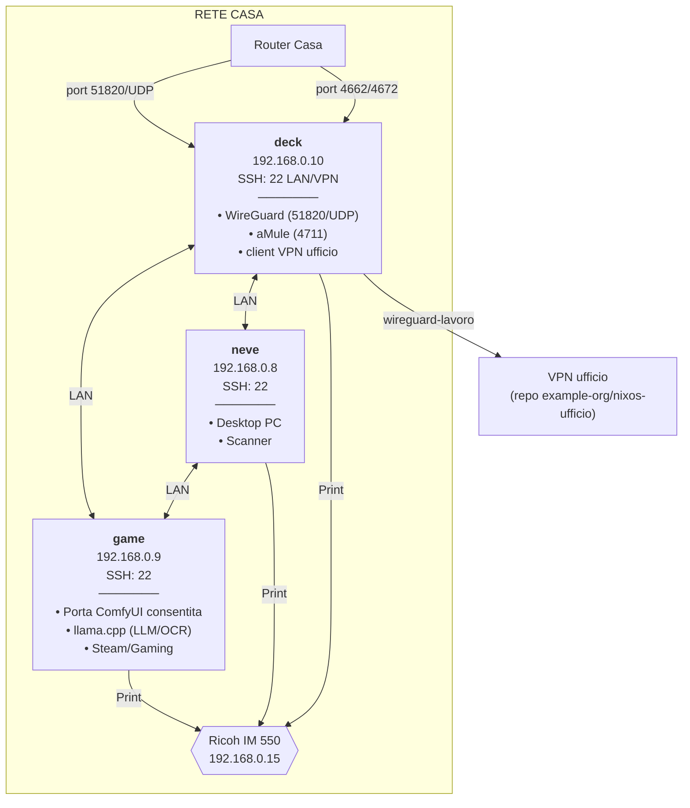

# Network architecture

Tre host sulla rete di casa. Gli alias SSH sono comuni; la raggiungibilità
dalla VPN casa e verso l'ufficio dipende dai tunnel e dai percorsi descritti
in `ssh-matrix`. La rete lavoro e la coppia server `norvegia`/`svezia`
vivono nel repo `example-org/nixos-ufficio`: qui resta solo ciò che
`deck`, `game` e `neve` dichiarano verso l'ufficio (§ Accesso all'ufficio da
casa).

Le fonti dichiarative sono i file identity, gli host e i moduli WireGuard.
Forwarding router e DNS pubblico sono un assetto operativo da verificare sui
rispettivi pannelli: il flake non li applica. Una regola firewall descrive
traffico consentito, non un servizio necessariamente in ascolto.



## Domini esterni

- **`home.example.com`** — risolve verso Router casa; ruolo: endpoint WireGuard pubblico (`deck:51820/UDP`)

Il dominio casa individua l'endpoint WireGuard domestico. SSH non è esposto
direttamente sulla WAN: ogni altro accesso vive in LAN o dietro VPN.

## Port Forwarding Router Casa

- **51820** — destinazione: 192.168.0.10:51820/UDP; servizio: WireGuard VPN
- **4662** — destinazione: 192.168.0.10:4662; servizio: aMule TCP (eDonkey)
- **4672** — destinazione: 192.168.0.10:4672; servizio: aMule UDP (Kad/eDonkey)

## Convenzione firewall custom

Le regole firewall manuali devono integrarsi con la chain `nixos-fw`, cioè la chain gestita dal firewall NixOS. Quando non esiste un'opzione nativa adatta, le regole in `networking.firewall.extraCommands` usano `iptables -A nixos-fw` e terminano con `-j nixos-fw-accept`. Questo mantiene le eccezioni host-specifiche nello stesso punto logico delle regole generate da NixOS.

Le opzioni native restano preferite per le aperture semplici, ad esempio porte TCP/UDP generiche o opzioni `openFirewall` dei moduli servizio. `extraCommands` è riservato a vincoli per subnet o casi specifici come servizi LAN/VPN-only.

## Nomi degli host

La rete casa non ha mDNS né un DNS locale su cui contare per gli host del
repo. Per questo i nomi sono dichiarati in `/etc/hosts`, ricavati dai file
identity, con lo stesso indirizzo ovunque compaiono:

- **host casa** (`deck`, `neve`, `game`) — l'IP della LAN casa, su tutti e
  tre (`o3/modules/system/host-names.nix`, importato da `o3/hosts/default.nix`);
- **server e dispositivi LAN ufficio** (`norvegia`, `svezia`, `danea2`) —
  l'IP della LAN lavoro, solo su deck, l'unico che la raggiunge (opzione
  `hosts` del client VPN ufficio, § Accesso all'ufficio da casa).

Gli alias ssh di `o3/modules/home/ssh-home-lan.nix` e, solo su deck,
`o3/modules/home/ssh-work-lan.nix` restano: portano utente e chiave, i nomi
qui servono a tutto il resto (browser, ping, curl).

## Accesso all'ufficio da casa

`deck` è client della VPN ufficio con l'interfaccia `wireguard-lavoro`,
avviata al boot (`o3/modules/system/services/wireguard-work-client.nix`,
valori in `~/.config/nixos/identity/work.nix`: indirizzo di deck, endpoint e chiave
pubblica del server). All'ufficio si accede solo da deck (decisione del
custode del 2026-11-05): il client non maschera la LAN casa, e la rotta di
`o3/modules/system/home-vpn-route.nix` su `game` e `neve` porta solo la
subnet della VPN casa. Se `wireguard-lavoro` non è attivo, il traffico di deck verso
l'ufficio esce su internet e non arriva.

Il server della VPN ufficio, i peer e il firewall dei server sono nel repo
`example-org/nixos-ufficio`. Lo standby resta client manuale della VPN casa di deck
(`wireguard-home`): la sua chiave pubblica è dichiarata fra i peer di deck.

## Servizi Rete Casa

- **deck** — servizio: WireGuard; porta: 51820/UDP; accesso: Pubblico
- **deck** — servizio: aMule; porta: 4711; accesso: LAN/VPN
- **game** — porta predisposta per ComfyUI: 8188; sorgente ammessa: la LAN
  casa `192.168.0.0/24`; servizio esterno al flake, da verificare sull'host
  secondo `client-desktop-architecture`
- **game** — servizio dichiarato: llama.cpp (LLM/OCR); porta: 11434;
  sorgente ammessa: la LAN casa `192.168.0.0/24`; i peer VPN arrivano
  mascherati dal NAT di deck, con sorgente LAN

## Presentazione sulla LAN

Decisione del custode (2026-10-03): ogni progetto ha un host privilegiato che
ne serve in modo permanente le viste generate alle sole reti private, e
`python3 o3/view/serve.py` lanciato a mano ascolta per default sulla
porta 8000. Repo e porte vivono in un solo registro, `o3/presentations.nix`
(`deck`: `method` 8001, `nixos` 8002, `salute` 8003, `economia` 8004). Le
viste di `bi` e `baserow` sulla production le dichiara il repo
`example-org/nixos-ufficio`. Il modulo home `o3/modules/home/presentations.nix` ne
genera un servizio utente `presentazione-<repo>` per repo. Per un repo fuori
dalla forma pubblicata il servizio lancia `o3/view/serve.py --port` dal
checkout e resta saltato se manca `view/index.html`: dal 2026-10-07 nessun
repo è in questa forma e il ramo è inerte. La forma vecchia `presentation/`
(prescrizione di metodo `migrazione-viste`), con il suo wrapper e le unit
`-vista`, è uscita dal modulo il 2026-10-07. Si gestiscono senza sudo:

```bash
systemctl --user status 'presentazione-*'
systemctl --user restart presentazione-nixos
```

**Forma pubblicata** (prescrizione di metodo `viste-fuori-da-git`, elenco
`published` del registro: tutti i repo di `deck`, cioè `method`, `nixos`,
`salute` ed `economia`). Le viste non si
servono più dal checkout ma da una cartella di pubblicazione fuori dal
working tree, `~/.local/state/view/<repo>`. La unit oneshot
`presentazione-<repo>-pubblicazione` lancia `build.py --publish` dal
checkout, con `git`, `pandoc`, `prettier` e `python3` presi dal flake e non
dal profilo. Il build parte dal commit di `HEAD` esportato con
`git archive`, quindi le modifiche locali non entrano, e il puntatore
`current` si sposta solo a build riuscita. `presentazione-<repo>` lancia
`serve.py --publish-root` e rilegge il puntatore a ogni richiesta, quindi uno
scambio di versione non chiede riavvii.

- **Codice del server.** Lo scambio ricarica le viste, non il codice del
  server: il processo resta quello avviato, con `serve.py` e i moduli locali
  che importa (`ciclo`, e tramite questo `project` e `sources`). All'avvio il
  server scrive l'hash dell'albero committato di `o3/view`
  (`git rev-parse HEAD:o3/view`) in
  `~/.local/state/presentazione/<repo>.serve`; dopo ogni pubblicazione, se
  il server gira e l'hash è cambiato, la unit lo riavvia (`try-restart`).
  Il riavvio segue quindi i commit, come la pubblicazione: le modifiche in
  corso nel checkout non lo fanno scattare, e l'albero copre gli import senza
  elencarli. Il timer da 5 minuti limita il ritardo. Limite: se il server
  riparte per un altro motivo (crash, login) col checkout modificato, esegue
  i file su disco, modifiche comprese. Il rischio è basso, perché un ciclo
  autonomo parte solo a checkout pulito e il codice di `o3/view` arriva con
  `/method` in sessione.

- **Innesco.** La path unit `presentazione-<repo>-pubblicazione.path` osserva
  `.git/logs/HEAD`. Ogni spostamento di `HEAD` (commit, checkout, un pull)
  la fa scattare. Un `git fetch` non la fa scattare, e nessuna unit fa fetch
  o pull (decisione del custode del 2026-10-07): il
  pull lo fa il custode o l'agente in sessione, che dal 2026-10-09 lo esegue
  senza richiesta (`CLAUDE.md` «Pull remoto») e così ripubblica le viste. Un commit che arriva durante una build lo raccoglie
  `publish.py` nello stesso giro. Resta però una finestra di qualche
  millisecondo: tra l'ultimo controllo di `HEAD` di `publish.py` e la fine
  della oneshot (`ExecStartPost`) la path unit non è riarmata, e
  `PathChanged` non recupera il cambio (osservato e riprodotto il
  2026-10-07).
- **Controllo periodico.** Accanto alla path unit, che resta l'innesco
  rapido, il timer `presentazione-<repo>-pubblicazione.timer` avvia la
  stessa oneshot ogni 5 minuti dalla sua ultima chiusura
  (`OnUnitInactiveSec`), e 5 minuti dopo l'avvio del gestore utente
  (`OnStartupSec`). Il giro è
  idempotente: con `HEAD` già servito `publish.py` risponde «già servito» in
  un decimo di secondo, senza costruire. Recupera il cambio perso dalla path
  unit e ritenta una build fallita, entro un intervallo più l'`AccuracySec`
  predefinito di 1 minuto (canone `method/kb/view.md`, «recupero»). A mano:
  `systemctl --user start presentazione-<repo>-pubblicazione`.
- **Avvio e recupero.** La pubblicazione è anche `WantedBy=default.target`,
  e il server la ordina prima di sé con `Wants`/`After`. Al login si
  ripubblica quindi un output arretrato prima di servire. Se la build
  fallisce, il server parte comunque sull'ultima versione buona e l'errore
  si legge su `http://deck:8001/_stato`.
- **Switch Home Manager.** Ogni `home-manager switch` rilancia le
  pubblicazioni, anche quando la generazione non cambia: la oneshot non ha
  `RemainAfterExit`, quindi a riposo è `inactive`, e l'attivazione avvia le
  unit `WantedBy=default.target` che trova ferme (osservato il 2026-10-19 a
  generazione invariata: `Result=success`, server delle viste mai fermati).
  Con `HEAD` già servito il giro è il «già servito» idempotente; se
  `o3/view` è cambiato, la pubblicazione riavvia il server (`try-restart`,
  sopra). Uno switch non è quindi neutro per le viste, anche quando la home
  non cambia.
- **Nessuna versione valida.** `serve.py` esce con 3, distinto dall'1 di un
  crash qualsiasi. L'`ExecCondition` lancia `serve.py` con `--check`:
  l'uscita 3 lascia il server saltato, non fallito, senza riavvii, con la
  diagnosi e `status.json` nel journal. Se la versione
  sparisce mentre il server gira, `RestartPreventExitStatus=3` evita il
  ciclo di riavvii. La prima pubblicazione riuscita lo avvia da sé
  (`ExecStartPost`).
- **Interruzione.** Uno stop o il timeout di 5 minuti della oneshot mandano
  SIGTERM. `publish.py` chiude il giro senza lasciare `.lock` né `.partial`,
  e la versione servita resta.

```bash
journalctl --user -u presentazione-method-pubblicazione -n 20
curl -s http://localhost:8001/_stato
```

Il firewall ammette le porte delle presentazioni solo dalle reti private, e
le ricava dallo stesso registro:

- **tutti gli host** (`deck`, `game`, `neve`) — 8000 dalla LAN casa
  `192.168.0.0/24` (`o3/hosts/default.nix`). I peer della VPN
  casa raggiungono `game` e `neve` mascherati dal NAT di deck, quindi con la
  sua sorgente LAN: per loro basta la regola LAN;
- **`deck`** — in più 8001-8004 dalla LAN casa e 8000-8004 dalla VPN casa
  `10.20.0.0/24`, così ci arrivano anche lo standby e il telefono
  (`extraCommands` dell'host).
  La rete pubblica non è mai ammessa; senza un server sulla porta non ascolta
  nessuno.

Stato: `deck`, `game` e `neve` hanno regole, rotta e servizi attivi dal
2026-10-03.

## Inserimento delle misure pressorie su deck

La PWA di `~/salute/o3/pressione/` è servita dall'unità utente permanente
`pressione-salute`, installata dal profilo `stele@deck`. Porta TCP 8010 e
nome della cartella di stato sono registrati in `o3/pressione.nix`, letto
dal modulo home `o3/modules/home/pressione-salute.nix` e dal firewall di
`deck`: ammesse solo LAN casa `192.168.0.0/24` e VPN casa `10.20.0.0/24`.
Nessuna apertura generica né forwarding sul router.

Il servizio esegue `python3 o3/pressione/serve.py --port 8010` dal checkout
`~/salute`, con casella esplicita `%S/pressione-salute/inserite.jsonl` e
`StateDirectory=pressione-salute`. Il checkout è in sola lettura nel
servizio; `PYTHONDONTWRITEBYTECODE=1` evita anche i file Python compilati.
La cartella ha permessi 0700, la casella 0600, proprietario `stele`.
`ciclo-salute`, eseguito dallo stesso utente, vede la home in sola lettura
e può leggere la casella senza ulteriori permessi. Il server non importa
misure nel repository e non fa commit; l'importazione compete a salute.
Il lingering di `stele`, già configurato su deck, mantiene il servizio
anche senza sessione aperta.

Dal telefono:

- su Wi-Fi casa: `http://192.168.0.10:8010/`;
- su rete mobile con VPN casa attiva: `http://10.20.0.1:8010/`;
- aggiungere il collegamento alla schermata Home dal browser. In HTTP il
  service worker resta inattivo; HTTPS è un eventuale secondo passo.

Verifica del 2026-10-20: Home Manager applicato, unità abilitata e attiva,
pagina HTTP 200 in loopback, casella vuota creata con i permessi previsti;
valutazione Nix delle due regole firewall riuscita. L'apertura runtime
attende il rebuild di deck da parte del custode; il collaudo da telefono
su LAN e VPN resta da fare dopo il rebuild. Le tre misure reali, la loro
importazione e il confronto con la memoria del misuratore restano nella
sessione salute, che conserva anche la successiva rimozione delle foto.

```bash
systemctl --user status pressione-salute
journalctl --user -u pressione-salute -n 20
```

Connessioni:

- [home-lan-addresses](home-lan-addresses.md)
- [ssh-matrix](ssh-matrix.md)
- [wireguard-home](wireguard-home.md)
- [client-desktop-architecture](client-desktop-architecture.md)
- [game-local-llm](game-local-llm.md)
