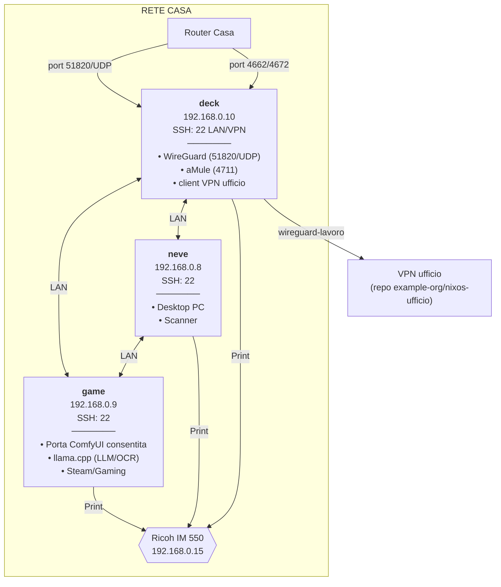

# Network architecture

Tre host sulla rete di casa. Gli alias SSH sono comuni; la raggiungibilità
dalla VPN casa e verso l'ufficio dipende dai tunnel e dai percorsi descritti
in `ssh-matrix`. La rete lavoro, il server `svezia` e la postazione di sviluppo
`norvegia` vivono nel repo `example-org/nixos-ufficio`: qui resta solo ciò che
`deck`, `game` e `neve` dichiarano verso l'ufficio (§ Accesso all'ufficio da
casa).

Le fonti dichiarative sono i file identity, gli host e i moduli WireGuard.
Forwarding router e DNS pubblico sono un assetto operativo da verificare sui
rispettivi pannelli: il flake non li applica. Una regola firewall descrive
traffico consentito, non un servizio necessariamente in ascolto.

## Domini esterni

- **`home.example.com`** — risolve verso Router casa; ruolo: endpoint WireGuard pubblico (`deck:51820/UDP`)

Il dominio casa individua l'endpoint WireGuard domestico. SSH non è esposto
direttamente sulla WAN: ogni altro accesso vive in LAN o dietro VPN.

## Port Forwarding Router Casa

- **51820** — destinazione: 192.168.0.10:51820/UDP; servizio: WireGuard VPN
- **4662** — destinazione: 192.168.0.10:4662; servizio: aMule TCP (eDonkey)
- **4672** — destinazione: 192.168.0.10:4672; servizio: aMule UDP (Kad/eDonkey)

## Convenzione firewall custom

Le regole firewall manuali devono integrarsi con la chain `nixos-fw`, cioè la chain gestita dal firewall NixOS. Quando non esiste un'opzione nativa adatta, le regole in `networking.firewall.extraCommands` usano `iptables -A nixos-fw` e terminano con `-j nixos-fw-accept`. Questo mantiene le eccezioni host-specifiche nello stesso punto logico delle regole generate da NixOS.

Le opzioni native restano preferite per le aperture semplici, ad esempio porte TCP/UDP generiche o opzioni `openFirewall` dei moduli servizio. `extraCommands` è riservato a vincoli per subnet o casi specifici come servizi LAN/VPN-only.

## Nomi degli host

La rete casa non ha mDNS né un DNS locale su cui contare per gli host del
repo. Per questo i nomi sono dichiarati in `/etc/hosts`, ricavati dai file
identity, con lo stesso indirizzo ovunque compaiono:

- **host casa** (`deck`, `neve`, `game`) — l'IP della LAN casa, su tutti e
  tre (`o3/modules/system/host-names.nix`, importato da `o3/hosts/default.nix`);
- **host e dispositivi LAN ufficio** (`norvegia`, `svezia`, `danea2`) —
  l'IP della LAN lavoro, solo su deck, l'unico che la raggiunge (opzione
  `hosts` del client VPN ufficio, § Accesso all'ufficio da casa).

Gli alias ssh di `o3/modules/home/ssh-home-lan.nix` e, solo su deck,
`o3/modules/home/ssh-work-lan.nix` restano: portano utente e chiave, i nomi
qui servono a tutto il resto (browser, ping, curl).

## Accesso all'ufficio da casa

`deck` è client della VPN ufficio con l'interfaccia `wireguard-lavoro`,
avviata al boot (`o3/modules/system/services/wireguard-work-client.nix`,
valori in `~/.config/nixos/identity/work.nix`: indirizzo di deck, endpoint e chiave
pubblica del server). All'ufficio si accede solo da deck (decisione del
custode del 2026-11-05): il client non maschera la LAN casa, e la rotta di
`o3/modules/system/home-vpn-route.nix` su `game` e `neve` porta solo la
subnet della VPN casa. Se `wireguard-lavoro` non è attivo, il traffico di deck verso
l'ufficio esce su internet e non arriva.

Il server della VPN ufficio, i peer e il firewall degli host di lavoro sono nel repo
`example-org/nixos-ufficio`. La postazione di sviluppo `norvegia` è client manuale della VPN casa di deck
(`wireguard-home`): la sua chiave pubblica è dichiarata fra i peer di deck.

## Servizi Rete Casa

- **deck** — servizio: WireGuard; porta: 51820/UDP; accesso: Pubblico
- **deck** — servizio: aMule; porta: 4711; accesso: LAN/VPN
- **deck** — viste dei repo: 8001-8004 (e 8000 per il lancio a mano, su
  ogni host); PWA pressione: 8010; accesso: LAN e VPN casa, mai la rete
  pubblica. Unità, pubblicazione e regole in `deck-user-services`
- **game** — porta predisposta per ComfyUI: 8188; sorgente ammessa: la LAN
  casa `192.168.0.0/24`; servizio esterno al flake, da verificare sull'host
  secondo `client-desktop-architecture`
- **game** — servizio dichiarato: llama.cpp (LLM/OCR); porta: 11434;
  sorgente ammessa: la LAN casa `192.168.0.0/24`; i peer VPN arrivano
  mascherati dal NAT di deck, con sorgente LAN

Connessioni:

- [home-lan-addresses](home-lan-addresses.md)
- [ssh-matrix](ssh-matrix.md)
- [wireguard-home](wireguard-home.md)
- [client-desktop-architecture](client-desktop-architecture.md)
- [game-local-llm](game-local-llm.md)
- [deck-user-services](deck-user-services.md)
